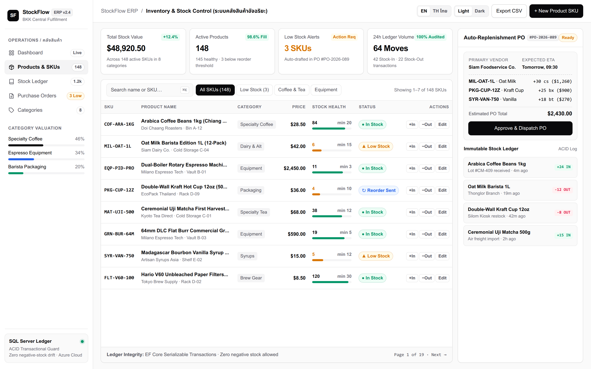

# StockFlow — Smart Inventory, Stock Ledger & Purchase Order System

A commercial-grade fullstack inventory and stock-control platform — tracked SKUs and categories,
atomic stock-in / stock-out movements with an immutable audit ledger, low-stock replenishment
alerts, and an executive KPI dashboard. Built with a clean Minimal + Modern (Shadcn / Vercel Geist)
interface, backed end-to-end by automated tests, and shipped as a single-command Docker Compose
stack or Azure Container Apps deployment.

[](https://github.com/peemphetpimolzzz/inventory-manager/actions/workflows/ci.yml)
[](LICENSE)



## Highlights for Operations & SME Teams

- **SKU & Category Catalog** — full CRUD with SKU uniqueness, unit price valuation, reorder thresholds, and server-side validation.
- **Immutable ACID Stock Ledger** — every stock-in / stock-out movement is recorded as an immutable ledger row; the product quantity and ledger entry are committed in a single SQL Server transaction, and any stock-out that would drive quantity below zero is rejected.
- **Low-Stock & Replenishment Alerts** — SKUs at or below their reorder level are flagged with visual stock health indicators and counted on the executive dashboard.
- **Minimal + Modern UI** — responsive Shadcn / Vercel Geist interface with tabular numerals, visual stock health bars, quick search (`⌘K` style), Light/Dark mode, and EN/TH bilingual support.
- **Self-Documenting OpenAPI** — Swagger UI generated directly from the ASP.NET Core controllers.
- **Turnkey Seeded Data** — populated on first startup so buyers and reviewers can evaluate workflows immediately.

## Tech stack

| Layer | Technology |
|-------|------------|
| Backend | ASP.NET Core (.NET), EF Core, SQL Server |
| Frontend | React, TypeScript, Vite (Shadcn / Vercel Geist Design System) |
| Web server | nginx (serves the SPA and reverse-proxies `/api`) |
| Tests | xUnit (unit + integration), Playwright (end-to-end) |
| Infrastructure | Docker Compose (local), Bicep + Azure Container Apps (cloud) |
| Cloud | Azure Container Apps, Azure SQL Database, ACR, Key Vault (OIDC CI/CD) |

## Quick start

> Prerequisites: **Docker and git only.** No .NET, Node, or SQL Server installation needed.

```bash
git clone https://github.com/peemphetpimolzzz/inventory-manager.git
cd inventory-manager
cp .env.example .env
docker compose up --build
```

Then open:

- Web app — <http://localhost:8080>
- API docs (Swagger) — <http://localhost:8081/swagger>

The database schema is migrated and seeded automatically on startup.

## Architecture

```
browser ─▶ web (nginx)  ──/api──▶  api (ASP.NET Core)  ──▶  db (SQL Server)
              static SPA              EF Core + Swagger          persisted volume
```

nginx serves the built React app and reverse-proxies `/api` to the API container, so the
browser only ever talks to one origin — no CORS configuration is required in production.

## Deploy to Azure

The same container runs in the cloud on **Azure Container Apps**, backed by an **Azure SQL
Database**. Infrastructure is defined as Bicep in [`infra/`](infra/), and the
[`Deploy (Azure)`](.github/workflows/deploy.yml) workflow builds the image in ACR and rolls
out a new revision — authenticating with **OIDC federated credentials**, so no long-lived
cloud secret is stored in the repo. The database connection string is kept in **Key Vault**
and injected as a referenced secret.

See [`docs/deployment.md`](docs/deployment.md) for the full walkthrough (provisioning, OIDC
setup, and teardown).

## Running the tests

```bash
# Unit tests (pure stock rules — no database)
docker run --rm -v "$PWD:/src" -w /src mcr.microsoft.com/dotnet/sdk:10.0 \
  dotnet test backend/tests/InventoryManager.UnitTests/InventoryManager.UnitTests.csproj

# Integration tests (real API against a throwaway SQL Server)
docker compose -f docker-compose.yml -f docker-compose.test.yml run --rm integration-tests

# End-to-end tests (Playwright against the full running stack)
docker compose up -d --build
docker compose -f docker-compose.yml -f docker-compose.test.yml run --rm e2e
```

All three suites also run on every push via GitHub Actions (`.github/workflows/ci.yml`).

## Project structure

```
inventory-manager/
├── backend/
│   ├── src/InventoryManager.Api/      # ASP.NET Core API (Domain, Data, Features)
│   └── tests/                         # xUnit unit + integration tests
├── frontend/                          # React + TypeScript + Vite, served by nginx
├── e2e/                               # Playwright end-to-end tests
├── infra/                             # Azure Bicep IaC (Container Apps, Azure SQL, ACR, Key Vault)
├── docs/deployment.md                 # Cloud provisioning & OIDC CI/CD walkthrough
├── docker-compose.yml                 # db + api + web
├── docker-compose.test.yml            # test database + test runners
└── .github/workflows/                 # CI (unit, integration, e2e) + Azure OIDC deploy
```

## License

[MIT](LICENSE) — Part of [Peem Phetpimol's portfolio](https://peemphetpimolzzz.github.io) (Fullstack & Cloud Engineer · Test Automation).
